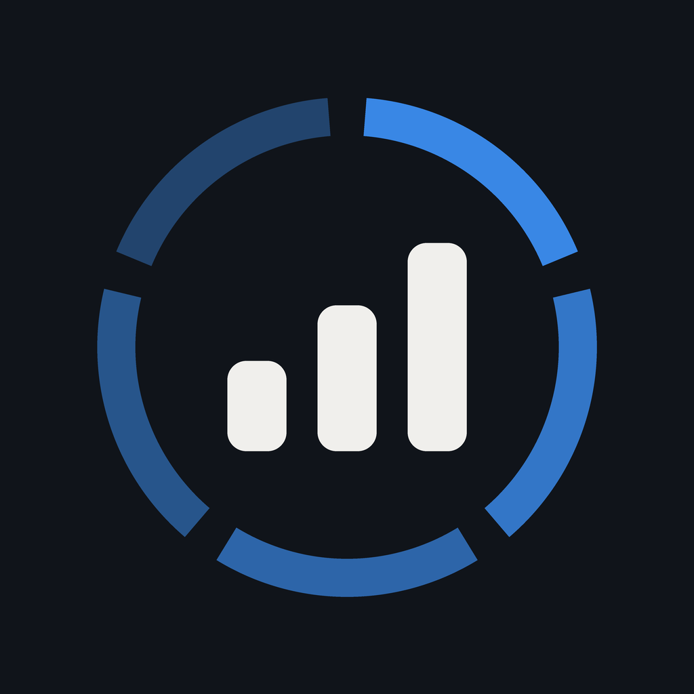

# InstAnalytics



Personal Instagram analytics, built on the official API. A Spring Boot service captures
every metric Meta exposes for your account — including story insights, which Instagram
**deletes after 24 hours** — and a SwiftUI app reads them back.

The headline feature is the story archive. Instagram's own archive keeps your old stories
but not their numbers; once the 24-hour window closes, reach, exits and replies for that
story are gone at every access tier. This service captures them every 30 minutes while
they're live and keeps them permanently, with the per-frame navigation funnel
(tapped forward / tapped back / skipped to the next account / exited) that tells you which
frame lost people.

## What's here

| Path | What |
|---|---|
| `backend/` | Spring Boot 3.5, Java 21, Postgres, Flyway. Collectors, token handling, REST API. |
| `ios/` | SwiftUI + Swift Charts, iOS 17+. Project generated with XcodeGen. Ships with demo data. |
| `.github/workflows/backend.yml` | Builds and tests the backend on every push. |
| `.github/workflows/ios-build.yml` | Builds the iOS app into an `.ipa` on a macOS runner. |

### Status

**Working now**

- Story capture every 30 min — every metric Meta returns for stories, plus the navigation breakdown
- Permanent story archive with derived exit rate, rewatch rate and cross-frame retention
- Long-lived token handling: encrypted at rest (AES-GCM), refreshed on a schedule well before the 60-day cliff
- Connect via OAuth, or by pasting a token from Meta's dashboard
- iOS app: archive, per-frame funnel, views-over-time, retention-by-position, with demo mode
- `IgMetricCatalog`: every media and account metric current as of November 2026, with tests

**Schema and API client ready, collectors next**

- Daily account insights (views, reach, accounts engaged, interactions, follows/unfollows)
- Post and reel sync with insight snapshots over time
- Follower demographics, snapshotted daily (Meta only gives the current state — history is something only you'll have)
- Business Discovery watchlist for benchmarking public Business/Creator accounts

## Setup

### 1. Your Instagram account

Must be **Business** or **Creator**. Personal accounts have had no API access since
December 2024. Switching is free and reversible: Instagram → Settings → Account type and tools.

### 2. A Meta app

1. [developers.facebook.com](https://developers.facebook.com) → **Create app** → Business type.
2. Add the **Instagram** product → **API setup with Instagram login**.
3. Add your Instagram account under the app's roles (Instagram testers). In development
   mode an app works for accounts with a role on it — no App Review needed for your own account.
4. Note the **Instagram app ID** and **app secret** for `.env`.

### 3. Run the backend

```bash
cp .env.example .env
openssl rand -base64 32          # paste the output as IG_TOKEN_KEY in .env
docker compose up -d db

cd backend
set -a; . ../.env; set +a
mvn spring-boot:run
```

### 4. Connect your account — pick one

**Easiest:** in the Meta dashboard, *API setup with Instagram login → Generate access tokens*,
then:

```bash
curl -X POST localhost:8080/auth/token \
  -H 'Content-Type: application/json' \
  -d '{"accessToken": "IGAA..."}'
```

**Or OAuth:** register `IG_REDIRECT_URI` in the dashboard and open
`http://localhost:8080/auth/instagram`. Meta may insist on an HTTPS redirect; if it rejects
`localhost`, use the token route above or a tunnel (cloudflared, ngrok).

Story capture starts within 30 minutes. Post a story to see it land.

### 5. The app on your iPhone

**From CI (no Mac needed):** Actions → *Build iOS app* → latest run → download
`InstAnalytics-ipa`. Install it with [Sideloadly](https://sideloadly.io) or
[AltStore](https://altstore.io) using your own Apple ID. A free Apple ID means re-signing every
7 days; a paid developer account lasts a year.

**From Xcode:**

```bash
brew install xcodegen
cd ios && xcodegen generate && open InstAnalytics.xcodeproj
```

Pick your team under Signing, plug in your phone, run.

Then in the app: **Settings → turn off demo data → server URL** = your machine's LAN address,
e.g. `http://192.168.1.23:8080`. Plain HTTP is allowed for local-network addresses only.

## API

| Endpoint | Returns |
|---|---|
| `GET /api/stories` | The archive, newest first, with exit / rewatch / retention per frame |
| `GET /api/stories/{id}/timeline` | Every capture of one frame — how its numbers accumulated |
| `GET /api/stories/summary?days=30` | Totals and averages for the window |
| `GET /api/stories/retention-curve?days=90` | Average % of frame-1 viewers still watching at each position |
| `GET /auth/instagram` | Start OAuth |
| `POST /auth/token` | Import a dashboard-generated token |

## Limits that come from Meta, not this code

- **Stories:** insights exist for 24 hours only. Under 5 viewers, Meta withholds the numbers
  entirely (error 10) — the archive records that as "under 5 viewers" rather than missing.
- **Story replies** are always 0 for accounts in Europe and Japan.
- **Demographics and follows/unfollows** need at least 100 followers.
- **`impressions` no longer exists** — removed April 2025; `views` replaced it. Old tutorials still use it.
- **Saves** is `saved` on media but `saves` on the account. Not a typo here.
- **Story link taps** and the `total_*` metrics (which include boosted traffic) need Facebook Login.
- **Business Discovery** works only on Business/Creator targets, and only through Facebook Login.
- Media insights can lag up to 48 hours.

## What it deliberately doesn't do

No anonymous story viewing, no list of who unfollowed you, nothing from private or personal
accounts, no private API. Those exist only in modded clients that break Instagram's terms and get
accounts banned. Everything here is the official API, for your own account.

## Your data

The Postgres volume is the **only copy** of your story history — Meta cannot give it back.
Back it up:

```bash
docker compose exec db pg_dump -U instanalytics instanalytics | gzip > backup-$(date +%F).sql.gz
```

Keep this backend on your home network. The API has no auth of its own.
